# PixelForge v1.0.0 — 2D Pixel Art & Game Asset Agent Skill

A pure-Python 2D pixel art & game asset engine and AI agent skill for generating **layered, multi-directional walking characters**, **seamless Wang/Blob autotiles**, **procedural pixel VFX**, **RPG items & 9-slice UI**, **fake-3D sprite stacks**, and exporting directly to **Aseprite (`.aseprite`)**, **Godot 4 (`.tres`)**, **Unity**, **Phaser 3**, **RPG Maker MV/MZ**, **GIF**, and **Indexed PNG**.

[](https://agent-skill-pixel-art.vercel.app/)
[](CHANGELOG.md)
[](LICENSE)

**21 CLI tools** · **8 Python engine modules** · **15-layer character rig** · **16 palettes** · **4 HTML5 studio tools** · **10 reference guides** · **67 automated tests**

Compatible with **Antigravity IDE**, **Claude Code**, **Codex CLI**, **Cursor**, **Gemini CLI**, and any AI agent supporting the `SKILL.md` convention. Zero external binary dependencies — Python 3.9+ and Pillow only.

---

## Live Interactive Showcase

Open **[agent-skill-pixel-art.vercel.app](https://agent-skill-pixel-art.vercel.app/)** to test-walk the 4-directional 32×32 hero with **WASD / Arrow Keys**, toggle individual paper-doll rig layers (`shadow`, `cape`, `torso`, `head`, `hair`, `sword`, `outline`) in real time, and browse all generated assets!

### 4-Direction Walk Cycle (32×32, 8 Frames, Layered Rig)

| Down (South) | Left (West) | Right (East) | Up (North) |
|---|---|---|---|
| 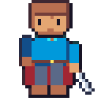 | 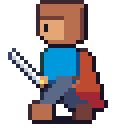 | 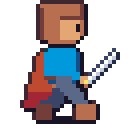 | 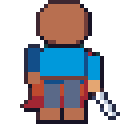 |

### All 8 Actions (Right Direction)

| Idle | Walk | Run | Jump | Attack | Cast | Hurt | Die |
|---|---|---|---|---|---|---|---|
| 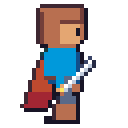 |  | 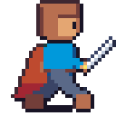 | 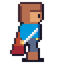 |  |  | 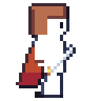 |  |

### Any Pixel Size (`8×8` to `64×64+`) & Any Frame Count (`2` to `60` Frames)

| 8×8 | 9×9 | 12×12 | 16×16 | 24×24 | 32×32 | 48×48 | 64×64 |
|---|---|---|---|---|---|---|---|
| 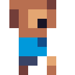 | 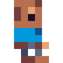 | 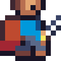 | 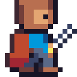 | 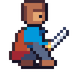 |  | 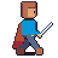 | 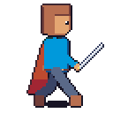 |

| 2f (4fps) | 3f (6fps) | 4f (8fps) | 5f (10fps) | 8f (12fps) | 12f (16fps) | 24f (24fps) | 60f |
|---|---|---|---|---|---|---|---|
|  |  |  |  |  |  |  |  |

### Tilesets, VFX, Fake-3D Sprite Stacking & Game Assets

| Grass Wang 16 | Iso Grass 2:1 | Explosion VFX | Fire Loop | Portal VFX | Fake-3D Rally Car | Voxel Tree |
|---|---|---|---|---|---|---|
|  | 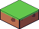 | 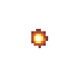 | 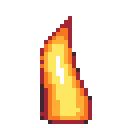 | 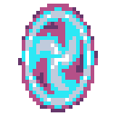 | 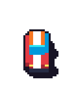 | 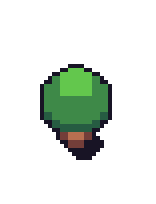 |

---

## Installation

### Antigravity IDE / Gemini CLI
```bash
cp -r skills/pixel-art ~/.gemini/config/skills/pixel-art
# Or per workspace:
cp -r skills/pixel-art .agents/skills/pixel-art
```

### Claude Code / Codex CLI / Cursor
```bash
cp -r skills/pixel-art ~/.claude/skills/pixel-art
# Or:
cp -r skills/pixel-art ~/.codex/skills/pixel-art
```

### Python Dependencies
```bash
pip install -r skills/pixel-art/requirements.txt
# Only requires Pillow>=9.0.0
```

---

## Quick Start Examples

```bash
# 1. Inspect engine presets & 16 palettes
python skills/pixel-art/scripts/pixel_studio.py info

# 2. Generate a 4-direction layered hero with .aseprite, Godot 4 .tres, RPG Maker 3x4, per-layer PNGs & GIFs
python skills/pixel-art/scripts/character_gen.py \
  --archetype hero --size 32 --dirs 4 --actions idle,walk,run,attack \
  --frames 8 --fps 10 --palette endesga-32 \
  --output-dir ./out/hero --aseprite --export-layers --godot --rpgmaker --gif --preview --json

# 3. Generate a 9x9 micro walker (2 frames) or 64x64 8-dir knight (12 frames)
python skills/pixel-art/scripts/character_gen.py --archetype hero --size 9 --dirs 4 --actions walk --frames 2 --fps 4 --output-dir ./out/micro9 --gif
python skills/pixel-art/scripts/character_gen.py --archetype knight --size 64 --dirs 8 --actions walk,attack --frames 12 --fps 16 --output-dir ./out/knight64 --aseprite --gif

# 4. Generate seamless Wang 16 / Blob 47 autotiles & 2:1 isometric blocks
python skills/pixel-art/scripts/tileset_gen.py --terrain grass --size 16 --mode blob47 --output ./out/grass_47.png --json
python skills/pixel-art/scripts/tileset_gen.py --terrain grass --size 64 --mode isometric --output ./out/iso_grass.png --json

# 5. Generate seeded procedural pixel VFX
python skills/pixel-art/scripts/vfx_gen.py --type explosion --size 32 --frames 12 --fps 16 --output ./out/boom.png --gif --aseprite --json

# 6. Generate fake-3D sprite stacking 360-degree turntable
python skills/pixel-art/scripts/sprite_stack.py --preset car --slices 12 --frames 16 --fps 12 --output-dir ./out/car --gif --json

# 7. Clean a messy / AI-generated PNG into strict palette-locked pixel art
python skills/pixel-art/scripts/sprite_clean.py --input raw.png --output clean.png --strip-checker --palette endesga-32 --json
```

---

## Architecture

```
skills/pixel-art/
├── SKILL.md                    # Agent entry point & craft rules
├── requirements.txt            # Pillow>=9.0.0
├── engine/                     # 8 modular pure-Python engine modules
│   ├── color.py                # Hue-shifted ramps, perceptual matching, 16 palettes
│   ├── canvas.py               # Multi-layer SpriteDocument, blend modes, linked cels, primitives, selout, rim light, cleanup
│   ├── character.py            # 15-layer rigged 1/2/4/8-dir character engine (8px..128px+, 2..60 frames, 9 archetypes)
│   ├── tileset.py              # Toroidal seamless FBM/Voronoi terrain, Wang 16 & Blob 47 autotiles, animated & 2:1 isometric
│   ├── vfx.py                  # 12 seeded procedural pixel VFX generators
│   ├── assets.py               # 10 RPG items, ZzSprite creatures, 5 UI components, fake-3D sprite stacking
│   ├── exporters.py            # Native .aseprite binary writer, Godot 4 .tres, Unity/Phaser/Aseprite JSON, RPG Maker 3x4, GIF, Indexed PNG
│   └── qa.py                   # Automated pixel art QA (AA, orphans, palette, jaggies/doubles, clipping, loop hygiene, seamlessness)
├── scripts/                    # 21 CLI tools (all support --help & --json)
├── palettes/                   # 16 curated palette JSON files
├── templates/                  # 4 zero-dependency HTML5 studio & walk-test tools
└── references/                 # 10 pixel-art craft guides
```

## Running Tests

```bash
pytest -v tests/test_engine.py
```

## Contributing & License

See [CONTRIBUTING.md](CONTRIBUTING.md) and [CHANGELOG.md](CHANGELOG.md). Released under the [MIT License](LICENSE).
